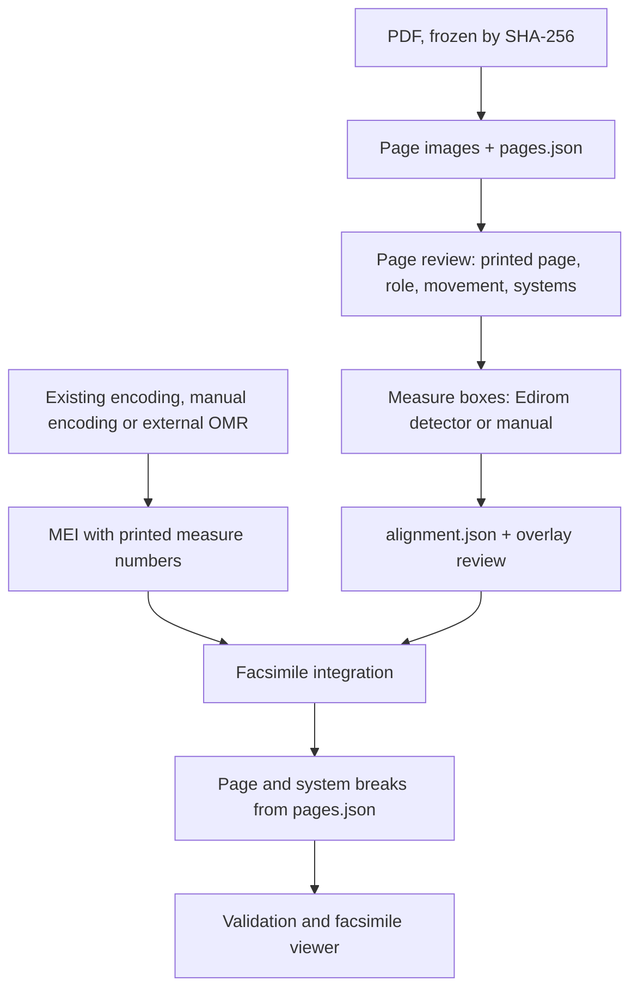

# Link MEI to a PDF facsimile

Use this workflow when the source of an edition is a PDF, such as a scanned
print or manuscript from IMSLP, a library or a publisher, rather than a IIIF
image service. The result matches the [IIIF route](edition-building.md#add-a-facsimile-and-measure-zones):
the MEI gets a `<facsimile>` with one `<surface>` per page, each
`measure/@facs` points to a zone on a page, and each `pb/@facs` points to its
surface. The images are local PNG files rasterized from the PDF. Graphics
refer to them by paths relative to the MEI file, so an edition folder can be
moved without breaking links.

The workflow was developed on a digital edition of Webern's *Variations for
Piano*, Op. 27, from the Universal Edition print of 1937: nine pages and 143
measure regions linked to three movements.



CAMAT does not recognize notes in images. Rasterizing a PDF only produces
pictures of its pages; the notation comes from an existing encoding, from
manual encoding, or from an optical music recognition (OMR) tool run outside
CAMAT. See [Get the notation](#4-get-the-notation).

## What the workflow keeps

- **The PDF is the witness.** Its bytes are never changed. Every derived file
  records the SHA-256 of the file it was made from: page images record the
  PDF, measure boxes record the page image, and reviews record both.
- **Physical and printed page numbers are separate.** In the Webern print,
  the first page of music is PDF page 1 but printed page 3. Both numbers are
  kept.
- **Measures are identified by movement and measure label**, not by the bare
  measure number. Measure 1 exists in every movement, and a measure split
  across a system or page break has more than one region.
- **Reviews are recorded, not assumed.** Equal numbers of boxes and measures
  do not prove a correct alignment. A review is tied to the hashes of what was
  reviewed and becomes invalid when the pixels or the boxes change.

## Folder layout

The helpers work on one facsimile folder per PDF, beside the edition's MEI:

```text
edition/
  mei/
    work.mei
  facsimiles/
    example-print-1900/
      example-print-1900.pdf
      pages.json              # page manifest: rendering record + page review
      pdfinfo.txt             # PDF page boxes and rotation, as Poppler reports them
      page-0001.png …         # rendered pages; often local only
      boxes/
        example-print-1900-p0003.json       # measure boxes (detector or manual)
        example-print-1900-p0003.run.json   # detector run record
      alignment.json          # measure ↔ region links and their review
      overlays/
        example-print-1900-p0003.png
```

From `mei/work.mei`, a page's graphic target is
`../facsimiles/example-print-1900/page-0003.png`. If the page images may not
be redistributed, keep them out of version control: the MEI still cites the
PDF and its hash, and `pages.json` lets anyone with the same PDF re-create
and verify the images.

## 1. Freeze the PDF

Keep the downloaded file unchanged and record where it came from: URL,
retrieval date, catalogue or plate number, rights statement and SHA-256.
Copy that record into the MEI header's `<sourceDesc>`. If the provider later
serves a different file under the same URL, that is a new source version
with a new hash, not an update of the old one.

## 2. Rasterize the pages

```bash
camat-pdf-facsimile render example-print-1900.pdf \
    --output-dir facsimiles/example-print-1900 --dpi 300
```

The Python equivalent is
`camat.pdf_facsimile.render_pdf_pages(pdf, output_dir, dpi=300)`. It needs
Poppler's `pdftoppm` and `pdfinfo` on `PATH`. Every physical page becomes
one `page-NNNN.png`; pages are never skipped at this stage. Coordinates are
image pixels with the origin at the top left, after Poppler has applied the
PDF's page rotation. A second run verifies the existing images against their
hashes and reuses them. It stops, instead of overwriting, when the PDF, the
resolution or the renderer version has changed.

The renderer writes `pages.json` with the review fields left empty:

```json
{
  "schema_version": 1,
  "source_id": "example-print-1900",
  "pdf": "example-print-1900.pdf",
  "pdf_sha256": "…",
  "page_count": 12,
  "dpi": 300,
  "renderer": "pdftoppm version 24.02.0",
  "coordinate_system": "image pixels; origin top-left; x right, y down",
  "pages": [
    {
      "page_id": "example-print-1900-p0003",
      "pdf_page_number": 3,
      "image": "page-0003.png",
      "width": 2480,
      "height": 3508,
      "sha256": "…",
      "printed_page": null,
      "role": "unreviewed"
    }
  ]
}
```

300 dpi is enough for measure detection and for reading the print. If a page
must be deskewed, rotated or cropped, save the result as a new image with its
own hash and record the transformation. Never reuse region coordinates on
pixels that have changed. A scan of two facing pages stays as one image;
crop it into two pages only as a recorded, separate derivative.

## 3. Review the pages

Open the images and fill in the review fields of `pages.json` by hand:

- `printed_page`: the page number as printed, as a string (`"3"`, `"iv"`),
  or `null` for an unnumbered page;
- `role`: `music`, or a reason the page has no measures, such as `cover`,
  `title`, `preface`, `blank`, `advertisement` or `duplicate`. Pages without
  music stay in the manifest with their role; nothing is dropped silently;
- for each `music` page, `mdiv`: the `@n` of the MEI `<mdiv>` (movement) the
  page belongs to;
- for each `music` page, `systems`: the measure labels of each printed
  system, top to bottom and left to right, as the print numbers them.

```json
{
  "page_id": "example-print-1900-p0004",
  "printed_page": "2",
  "role": "music",
  "mdiv": "1",
  "systems": [
    ["9", "10", "11", "12"],
    ["13", "14", "15"],
    ["16", "17", "18", "18"],
    {"mdiv": "2", "measures": ["0", "1", "2"]}
  ]
}
```

Measure labels are compared with `measure/@n` as strings. Unnumbered pickups
need a label too; this example uses `"0"`. A measure that starts at the end
of one system and continues on the next is listed at both places (`"18"`
above) and gets one region on each. When a new movement starts mid-page,
write that system as an object with its own `mdiv`. Record the systems from
the image, not from the encoding: this list is what the measure boxes are
checked against in step 6.

## 4. Get the notation

The MEI can come from three kinds of source:

- **An existing encoding** (MusicXML, Humdrum, MuseScore). Import it with
  [`camat-convert`](formats.md). Check its license before using it as a base,
  and read its header: an encoding may follow a different edition or leave
  out dynamics, slurs or beams. The Webern edition started from Humdrum
  files that encode the notes but not all of the print's markings.
- **Manual encoding**, for example in mei-friend.
- **OMR**, run outside CAMAT (Audiveris, HOMR or a similar tool), exported
  as MusicXML and imported with `camat-convert`. Expect to correct it
  measure by measure. In the Webern study, HOMR found 15 of the 18 measures
  on the first page.

Before linking, make the encoding match the print's numbering. Each
`measure/@n` must equal the label used in `pages.json`, including pickups,
and every `xml:id` must be unique. One MEI file can hold several movements as
separate `<mdiv>` elements, or each movement can be its own file.

**MEI version.** Verovio 6.3 writes `meiversion="6.0-dev"`, while CAMAT
validates against the MEI 5.1 CMN schema. `camat-convert --mei-version 5.1`
relabels the version, replaces hidden `mRest` elements with `mSpace`, keeps
both safe repeat lists as sibling `<expansion>` elements in source order,
without unrolling the repeats, and drops `dynam/@enclose` inside `supplied`,
retaining the editorial meaning. It validates
the result against 5.1 before saving. Any other invalid content, unsafe edit,
or missing `xmllint` is reported as `incomplete`; Verovio's file stays unchanged
at 6.0-dev. Changing the version attribute alone is not a conversion.

## 5. Find the measure regions

The [Edirom measure detector](https://measure-detector.edirom.de/) proposes
one box per measure and system. In CAMAT it is the same service that the
IIIF route uses:

```python
from camat.pdf_facsimile import detect_measure_boxes

detect_measure_boxes(
    "facsimiles/example-print-1900/pages.json",
    allow_upload=True,  # sends the music pages to the detector service
)
```

Only pages whose `role` is `music` are sent. The raw response for each page
is saved under `boxes/`, together with a run record holding the endpoint,
time and the hashes of the image and the response. Later runs reuse the
saved responses without network access. Without `allow_upload=True` the
call fails on the first page that has no saved response, so nothing is sent
by accident.

Boxes drawn by hand, or produced by another detector, go in the same place
and format: `boxes/<page_id>.json` with a `measures` list of
`{"ulx": …, "uly": …, "lrx": …, "lry": …}` pixel boxes. The detector pads its
boxes, so neighbouring boxes can overlap slightly; the original geometry is
kept.

## 6. Align measures to regions and review them

```python
from camat.pdf_facsimile import build_measure_alignment, draw_alignment_overlays

alignment = build_measure_alignment("facsimiles/example-print-1900/pages.json")
draw_alignment_overlays(alignment, "facsimiles/example-print-1900/overlays")
```

`build_measure_alignment` groups each page's boxes into systems by their
vertical position and sorts each system left to right. It then compares the
number of boxes per system with the `systems` lists of `pages.json`. If they
differ, it stops and names the page and the counts: a missing or extra box
would otherwise shift every following measure onto the wrong region. Fix the
boxes, or the system lists, and run it again. On success it writes
`alignment.json`, one link per region:

| Field | Meaning |
| --- | --- |
| `mdiv`, `measure_n` | the measure, as in `pages.json` and the MEI |
| `occurrence` | 1, or 2 for the second region of a split measure |
| `page_id`, `system` | where the region is |
| `bbox` | `[ulx, uly, lrx, lry]` in image pixels |
| `image_sha256`, `boxes_sha256`, `box_index` | the image and box file the region came from |

The overlays draw every region on its page image, labelled with
movement and measure. Look at each page: one box should span the whole
system (both staves of a piano score, all staves of a full score), the labels
should follow the printed measure numbers, and movement starts, pickups,
repeats and split measures should be where the print has them. Record the
result in the `review` section of `alignment.json`, one entry per page with
status (`unreviewed`, `approved` or `rejected`), reviewer, date and notes.
The entry stores the image and box hashes; if either changes,
`build_measure_alignment` marks that page unreviewed again.

## 7. Integrate the facsimile into the MEI

```python
from camat.pdf_facsimile import integrate_pdf_facsimile, write_page_breaks

integrate_pdf_facsimile(
    "mei/work.mei",
    "facsimiles/example-print-1900/pages.json",
    "facsimiles/example-print-1900/alignment.json",
    "mei/work.mei",
)
write_page_breaks("mei/work.mei", "facsimiles/example-print-1900/pages.json", "mei/work.mei")
```

`integrate_pdf_facsimile` writes one `<surface>` per music page of the
movements in the MEI file, with
`@n` set to the printed page, the image size, and a `<graphic>` whose target
is relative to the output MEI. Each region becomes a `<zone>`, and each
`measure/@facs` lists its zones (two for a split measure). Measures are
joined by `mdiv` and `@n`, so measure numbers that restart in every movement
are no problem. An existing `<pb>` gets `@facs` pointing to its surface
when the measure after it is the first measure on a printed page; other
`<pb>` elements are listed in the report. A movement can have its own MEI
file: regions of movements that are not in the file are left out. Running
the integration again replaces its own `<facsimile>` and keeps any other
facsimile, such as a IIIF one, together with the `@facs` links to it.

The integration checks that every measure of the linked movements has a
region and every region has a measure, and that the score itself is
unchanged: apart from the new `@facs` attributes, the `<body>` before and
after must be identical. It refuses an alignment that is older than the
page images, the boxes or the `systems` lists it was built from, and it
reports every page whose review is not `approved` or is out of date.

`write_page_breaks` is a separate, explicit rewrite. It replaces the
`<pb>` and `<sb>` elements of the linked movements with one break before the
first measure of each printed system, taken from `pages.json`, and links each
`<pb>` to its surface. Run it when the encoding should follow the print's
layout. Running it again on an unchanged file changes nothing.

Both operations copy XML in other namespaces byte for byte, such as the
`humxml` and MADS blocks that Verovio's Humdrum import embeds in the header.

## 8. Check and view

Validate the result with [general MEI validation](mei-validation.md):

```bash
camat-validate-mei mei/work.mei --output-dir mei/validation --verovio --camat-parse
```

This checks the MEI 5.1 schema, references, local graphic files, Verovio
rendering and CAMAT parsing. It needs the `validation` extra and `xmllint`.

Then open the [facsimile viewer](../api/facsimile_viewer.md) on the file and
check each page against the print:

```python
from camat import launch_interactive_facsimile_viewer

viewer = launch_interactive_facsimile_viewer(
    "mei/work.mei",
    verovio_breaks="encoded",
    verovio_options={"minLastJustification": 0},
)
```

With `verovio_breaks="encoded"` (the default), Verovio follows the print's
system breaks written in step 7. Before that step, `align_to_facsimile=True`
previews breaks inferred from the regions without changing the file.
Verovio leaves the last system unjustified when its natural width is under
80 % of the line (`minLastJustification`, default 0.8). Set it to 0 when the
print's last system runs to the right margin; keep the default when the
print ends mid-line.

## Records produced

| File | Written by | Contents |
| --- | --- | --- |
| `pages.json` | step 2, then edited in step 3 | PDF hash, rendering settings, one entry per physical page with image hash, size, printed page, role, movement and systems |
| `pdfinfo.txt` | step 2 | Poppler's page boxes and rotation for every page |
| `boxes/<page_id>.json` | step 5 | raw detector response or manual boxes |
| `boxes/<page_id>.run.json` | step 5 | detector endpoint, time, image and response hashes |
| `alignment.json` | step 6, review added by hand | one link per region; per-page review tied to hashes |
| `overlays/*.png` | step 6 | review images; can be re-created at any time |
| the MEI | step 7 | `<facsimile>`, `measure/@facs`, `pb/@facs`, optional breaks |

## Limits

- No OMR inside CAMAT, and no automatic crop, deskew or splitting of facing
  pages.
- The measure detector is an external web service: uploading sends the page
  images to it. Check that this is allowed for the source.
- System grouping assumes horizontal systems stacked down the page. Pages
  with inserts, ossia staves or rotated systems need manual boxes and a
  careful review.
- A review records that someone looked; it is not a musical collation of the
  encoding against the print.

Worked example: [`mei_pdf_facsimile_integration.ipynb`](../../notebooks/mei_pdf_facsimile_integration.ipynb)
walks through this workflow on the Buxtehude Suite (DdT vol. 11, appendix
no. 1) with a four-page BSB PDF.
