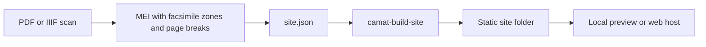

# From MEI to a web edition

`camat-build-site` turns finished MEI files into a static web edition: a
folder of files that any web host can serve, GitHub Pages included. Visitors'
browsers render each work with Verovio at its encoded page and system breaks.
The editorial notes (`<annot>`) appear beside the score, and the facsimile,
when there is one, appears next to it with a zone for every bar. Hovering a
symbol shows its bar and `xml:id`, and a link such as `#suite/10` opens a bar.

This is the last step of Workflow 1, after the facsimile has been linked by
the [PDF route](pdf-facsimiles.md) or the
[IIIF route](edition-building.md#add-a-facsimile-and-measure-zones). The
template is a starting point: it uses the standard library only, and a
project can copy and change the built files.

The template requires CAMAT 0.2.8 or newer.



## Which viewer to use

| Task | Tool |
| --- | --- |
| Check one MEI file while editing it, in Jupyter | [MEI facsimile viewer](../api/facsimile_viewer.md) (`notebooks/mei_facsimile_viewer.ipynb`) |
| Publish one or more works for readers | `camat-build-site` (this page) |

The notebook viewer reads the MEI again after every change and needs a
Python kernel. The web edition is a fixed build that a browser can show
without one.

## What the MEI needs

- **One MEI file per work.** File names must differ, because the site copies
  them into one folder.
- **`xml:id` on every `<measure>`.** Bars without one can't be selected; the
  build prints how many there are.
- **Page breaks.** Verovio renders with `breaks: encoded`, so each `<pb>`
  starts a page and each `<sb>` a system. Bars before the first `<pb>` are on
  the first page. Step 7 of the PDF route writes these breaks.
- **For a facsimile:** `pb/@facs` points to the page's `<surface>`, and
  `measure/@facs` points to the bar's `<zone>` on it. A bar split across two
  systems can point to a zone on each.

Optional:

- `<annot>` elements in `<music>` become the editorial notes. A note shows
  its `@label` (or else its `@type`) and its `<p>` paragraphs. It belongs to
  the bars of its `@plist` targets, or to the bar it sits in. `<ref target>`
  inside a paragraph becomes a link, resolved against `ref_base` or else
  against the MEI file's own URL.
- `editionStmt/edition` is shown under the title, with `@n` as the version:
  `<edition n="0.9.0">Digital edition</edition>` reads "Digital edition
  (version 0.9.0)".

## Build the PDF tutorial's result

The tutorial notebook
[`mei_pdf_facsimile_integration.ipynb`](../../notebooks/mei_pdf_facsimile_integration.ipynb)
leaves the Buxtehude Suite in `converted_mei/pdf_tutorial/`: the MEI with
facsimile and breaks in `mei/`, the page images and `pages.json` in `pages/`.
Save this as `converted_mei/pdf_tutorial/site.json`:

```json
{
  "title": "Buxtehude, Suite",
  "subtitle": "DdT vol. 11, appendix no. 1, linked to the BSB scan",
  "storage_prefix": "buxtehude-suite",
  "works": [
    {"id": "suite", "title": "Suite", "mei": "mei/Buxtehude-DdT11-app01-suite_pdf_facs_breaks.mei"}
  ],
  "facsimile": {
    "type": "pdf",
    "pages": "pages/pages.json",
    "pdf": true,
    "images": {"copy": true}
  }
}
```

Then build and preview it:

```bash
camat-build-site converted_mei/pdf_tutorial/site.json converted_mei/pdf_tutorial/_site
python -m http.server -d converted_mei/pdf_tutorial/_site
```

```text
Built …/converted_mei/pdf_tutorial/_site: 1 work, 89 bars (89 with a zone), 13 files, 3547 KB
```

Open <http://localhost:8000/#suite/10> to see bar 10 selected in the score
and on the scan. Opening `index.html` directly from disk does not work:
browsers load the viewer's modules only over HTTP.

`"images": {"copy": true}` copies the four page images into the site, so the
scan appears at once. Copy images only when you may publish them; otherwise
leave out `images`, and visitors open their own copy of the PDF.

## Site config

`site.json` is a JSON object. Paths in it are relative to the file's folder.
The build checks everything first and reports every problem together;
unknown keys are errors too.

| Key | Required | Meaning |
| --- | --- | --- |
| `title` | yes | Page title, and the heading unless `heading` is given |
| `storage_prefix` | yes | Lower-case letters, digits and `-`. It keeps this site's remembered settings apart from other sites on the same host |
| `works` | yes | List of works, see below |
| `version` | no | `1`, the only version so far; without it, 1 |
| `$schema` | no | URL or path of the JSON Schema below, for editors; the build ignores it |
| `description` | no | `<meta name="description">` text |
| `heading`, `subtitle` | no | Text above the score |
| `lang` | no | Language tag of the page (`<html lang>`), default `en`. It does not translate the interface |
| `links` | no | List of `{"text": …, "url": …}` shown under the heading |
| `footer` | no | Text above the credits line, or a list of text and `{"text": …, "url": …}` links |
| `labels` | no | Interface words, see below |
| `work_menu` | no | `"tabs"` or `"select"`; without it, more than 8 works come in a select |
| `verovio` | no | Verovio options, merged over the defaults below |
| `ref_base` | no | Base URL, ending in `/`, for relative `<ref target>` links in the notes |
| `facsimile` | no | `{"type": "pdf", …}` or `{"type": "iiif", …}`, see below |

Each work is `{"id", "label", "title", "mei"}`. `id` and `mei` are required.
`id` appears in links (`#<id>/<bar>`) and takes letters, digits, `_`, `.` and
`-`. `label` names the work in the tabs or select (default: `id`). `title`
names it in messages; without one, the viewer says "Movement" and the label.
With a single work, the menu is hidden.

A footer with a link:

```json
"footer": ["Encoding: ", {"text": "CC BY 4.0", "url": "https://creativecommons.org/licenses/by/4.0/"}, "."]
```

`labels` replaces any of these defaults:

| Key | Default |
| --- | --- |
| `work` | Movement |
| `bar`, `bars` | Bar, Bars |
| `notes` | Editorial notes |
| `facsimile` | Facsimile |
| `mark_notes` | Mark all notes |
| `bar_boxes` | Bar boxes |
| `hint` | Hover a bar or a symbol to see its bar number and xml:id. |

The Verovio defaults are those of the facsimile notebook: `breaks: encoded`,
`adjustPageHeight`, `footer: none`, `svgViewBox`, `condense: none`,
`scale: 35`, `spacingLinear: 0.25`, `spacingNonLinear: 0.6` and
`minLastJustification: 0`. Set `"minLastJustification": 0.8` when the print
leaves its last systems short (see
[Check and view](pdf-facsimiles.md#8-check-and-view)).

camat ships a JSON Schema of this format, `camat/schemas/site.schema.json`.
Editors such as VS Code then complete the keys and mark mistakes:

```json
"$schema": "https://raw.githubusercontent.com/egorpol/camat_v2/v0.2.8/camat/schemas/site.schema.json"
```

The schema checks keys, types and patterns. The build checks the rest: that
the files exist, that work ids are unique, that URLs are http(s) or relative,
and that the MEI matches the facsimile.

## PDF facsimile

For MEI linked by the [PDF route](pdf-facsimiles.md). The zones are in pixels
of the page images listed in `pages.json`. The build therefore checks that
every page the MEI shows is in `pages.json` with the same width and height.

```json
"facsimile": {
  "type": "pdf",
  "pages": "pages/pages.json",
  "pdf": {"url": "https://example.org/score.pdf", "text": "the library's copy"},
  "images": {"url": "https://example.org/scans/", "confirm": "These scans are in the public domain in …", "button": "Show the scan"}
}
```

| Key | Meaning |
| --- | --- |
| `pages` | `pages.json` of `camat.pdf_facsimile` (required) |
| `pdf` | `true`: visitors may open their own copy of the PDF. `{"url", "text"}` also says where to get it |
| `images.copy` | `true`: copy the page images into the site |
| `images.url` | https folder where the same images are hosted, under the names in `pages.json` |
| `images.confirm` | Notice shown before the images; the scan appears only after the visitor confirms it |
| `images.button` | Label of the button that shows the images |

Give `pdf`, `images` or both, and give `images` either `copy` or `url`.

- **The visitor's own PDF** is read in the browser with pdf.js and never
  uploaded. It stays in the browser's storage until "Hide the facsimile". A
  PDF whose SHA-256 differs from `pdf_sha256` in `pages.json` is still shown,
  with a warning, because its pages may not match the zones.
- **Page images** are checked against their SHA-256 in `pages.json`: copied
  ones when the site is built, hosted ones in the browser. An image that
  differs is not shown.
- **A confirmation** is remembered by the browser until "Hide the facsimile".

## IIIF facsimile

For MEI linked by the IIIF route. Each page's `<graphic>` already names a
IIIF Image API request, and its `@width` and `@height` give the pixel size
that the zones are measured in:

```xml
<surface xml:id="surface_0013" n="1">
  <graphic target="https://iiif.example.org/iiif/page13/full/4134,/0/default.jpg"
           width="4134" height="5523" mimetype="image/jpeg"/>
  <zone xml:id="zone_0013_m1" type="measure" ulx="310" uly="702" lrx="1180" lry="1435"/>
</surface>
```

```json
"facsimile": {"type": "iiif", "confirm": "…", "button": "Show the facsimile"}
```

`confirm` and `button` work as for PDF images. Both are optional; without
`confirm`, the scan appears at once. The build requires every page's target
to be an https request for the `full` region with no query string. The intro
names the image hosts.

The viewer asks the server for the width the pane needs, in steps of 500
pixels and never wider than the graphic: a 480-pixel pane on a screen with a
device pixel ratio of 2 requests `full/1000,/0/default.jpg`. It also loads
the next page in advance. The images load as plain images, so the server
needs no CORS headers. A visitor's browser contacts the image host directly.

## The output folder

The build writes:

- `index.html`, `viewer.js`, `viewer.css`, and `facsimile-pdf.js` or
  `facsimile-iiif.js`;
- `works.json` and `mei/` (the MEI files, unchanged);
- for a PDF facsimile, `facsimile/pages.json` and any copied page images;
- `.nojekyll` for GitHub Pages, and the marker `.camat-site`.

The output folder is replaced as a whole, after every check has passed. It
must be missing, empty, or an earlier build (it has `.camat-site`). Inside a
git repository, it must be named `_site`. It must not contain the config or
any input.

From Python:

```python
from camat.web_edition import SiteConfigError, build_site

try:
    report = build_site("site.json", "_site")
except SiteConfigError as error:
    print("\n".join(error.problems))
```

`build_site` also takes the config as a dict. Its paths are then relative to
`base_dir` (default: the current folder). The report lists the files written
and, for each work, its bars, bars with a zone, bars without `xml:id`, notes
and facsimile pages.

## Publish

Any static web host can serve the folder as it is. Visitors need an internet
connection: Verovio 6.3.0 loads from jsDelivr with a Subresource Integrity
check. pdf.js 6.3.289, needed only when a site offers the PDF, loads from
jsDelivr without one. For GitHub Pages, build into `_site` in a
GitHub Actions workflow and deploy that folder;
[webern_op27's workflow](https://github.com/egorpol/webern_op27/blob/main/.github/workflows/pages.yml)
is an example.

## Finished examples

Two editions in [Edition corpora](edition-corpora.md) publish viewers of this
kind. They came before the template and keep their own code, with
edition-specific additions:

- [Webern, *Variations for Piano*, Op. 27](https://egorpol.github.io/webern_op27/)
  ([repository](https://github.com/egorpol/webern_op27)): a PDF facsimile.
  Visitors confirm that the print is in the public domain where they are,
  then see hosted page images, or they open their own copy of the IMSLP PDF.
- [Buxtehude, instrumental works, DdT vol. 11](https://egorpol.github.io/DdT_1_vol_11/)
  ([repository](https://github.com/egorpol/DdT_1_vol_11)): IIIF images from
  the Bayerische Staatsbibliothek, with source excerpts in the notes.

## Limits

- One facsimile type per site, and zones for bars only.
- Only the `labels` words can be changed. The rest of the interface, such as
  "Loading Verovio…", "Open the PDF…", "Full-size image", the page label
  "p. 3 (3/9)" and the warnings, is in English whatever `lang` says.
- The IIIF adapter reads the `<graphic>` targets in the MEI, not IIIF
  manifests.
- No search, and no rendering on the server: every page is drawn in the
  visitor's browser.
- The built files are not a stable interface. A project that changes them
  keeps its own copy, as the two examples do.
